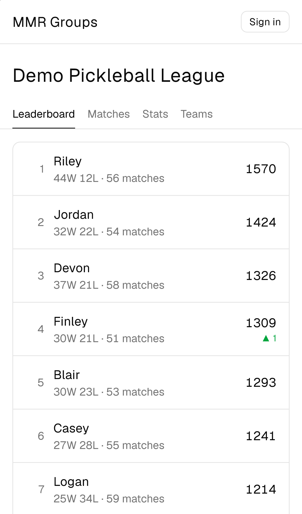

# MMR Groups

Skill ratings for your regular group: record who played and who won, and everyone gets an [OpenSkill](https://github.com/philihp/openskill.js) rating with a leaderboard, match history, player profiles, group stats and a balanced team generator. Built mobile-first for recording results courtside.

- **Live:** https://mmr-groups.whiterbread.workers.dev
- **Demo (no sign-in):** https://mmr-groups.whiterbread.workers.dev/g/demo



## Stack

TypeScript throughout. React, TanStack Router and Query, Tailwind + shadcn/ui, Recharts, PWA. Hono on Cloudflare Workers (static assets + API in one Worker), D1 with Drizzle. Google sign-in via Arctic. Vitest (API tests run in workerd), Playwright on Pixel 7 and iPhone 14. pnpm workspaces: `apps/web`, `packages/api`, `packages/core` (ratings, permissions, validation, stats, team generator — shared by browser and API).

Ratings are never stored: they're a pure replay of the match history, so editing any match just recalculates.

## Develop

Requires Node 24 and pnpm 12.

```sh
pnpm install
pnpm db:migrate:local
pnpm db:seed:demo --local
pnpm dev                     # http://localhost:5173
```

Google sign-in locally needs `apps/web/.dev.vars` with `GOOGLE_CLIENT_ID`, `GOOGLE_CLIENT_SECRET` and `SITE_ADMIN_EMAILS`, and `http://localhost:5173/api/auth/google/callback` as an authorized redirect URI on the OAuth client.

```sh
pnpm lint && pnpm typecheck
pnpm test                    # unit + API
pnpm e2e                     # Playwright, against a fresh local database
pnpm scenarios:check         # every required scenario has a tagged test
```

## How requirements work

Behaviour is specified as Given/When/Then scenarios with stable IDs in [`scenarios/`](scenarios). Tests are tagged with those IDs, and `scenarios:check` fails on tags that don't exist and reports scenarios without tests. The design is in [`PLAN.md`](PLAN.md); work is tracked in [`tasks/`](tasks/ROADMAP.md).

## Deploy

GitHub Actions: pull requests run every check and upload a preview (`pr-<n>` alias on the preview Worker). Merging to `main` migrates both databases, seeds the demo where missing, deploys preview and production, and smoke-tests production.
